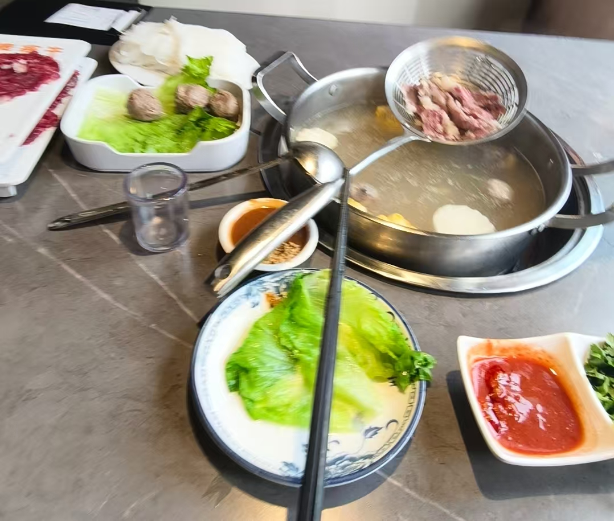
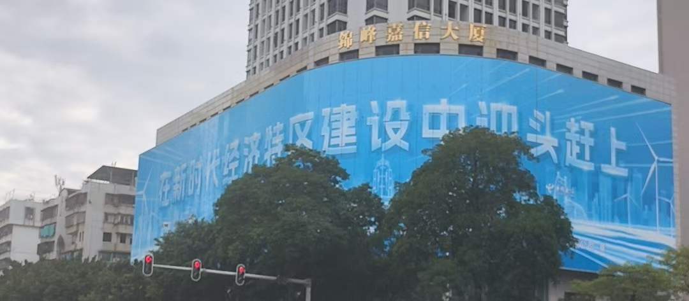
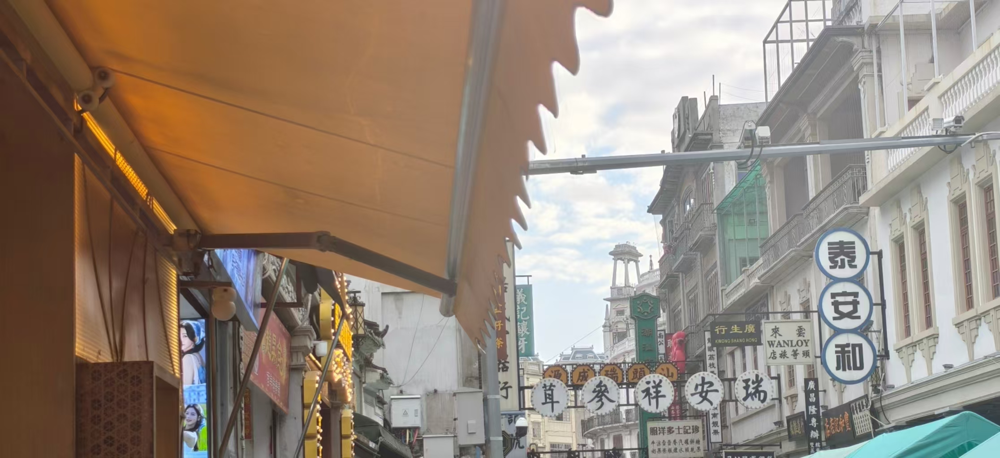
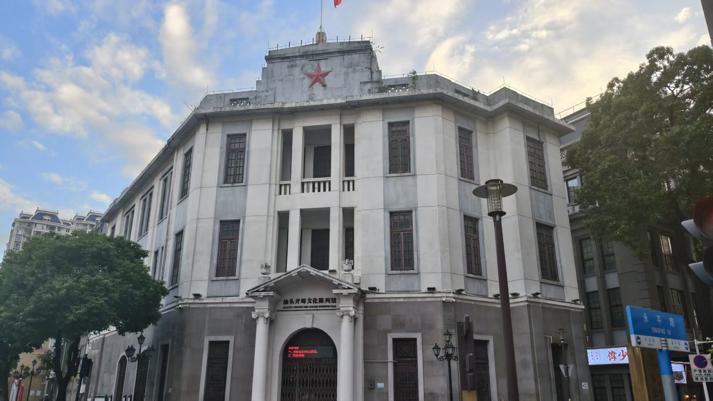
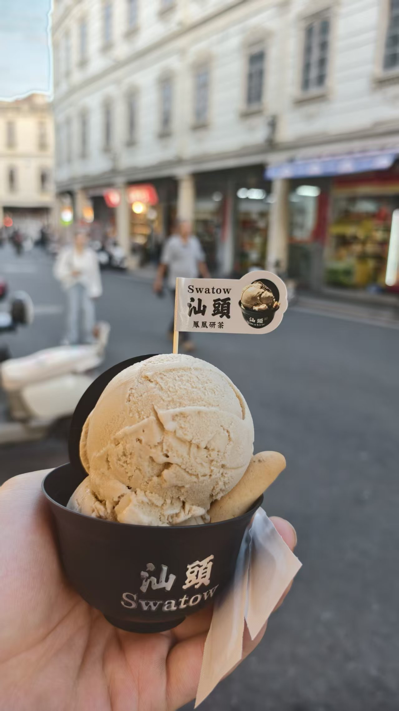
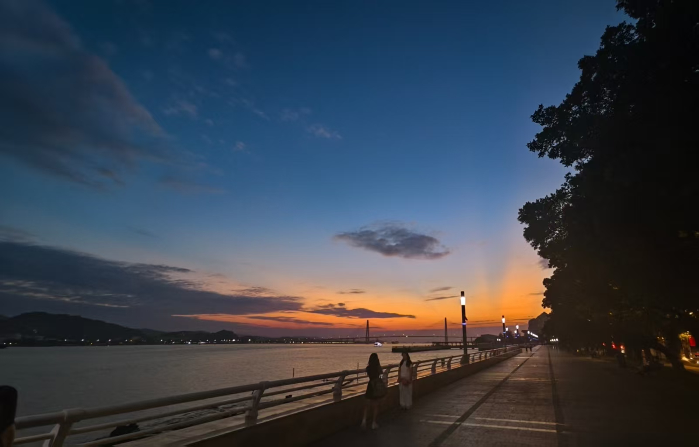
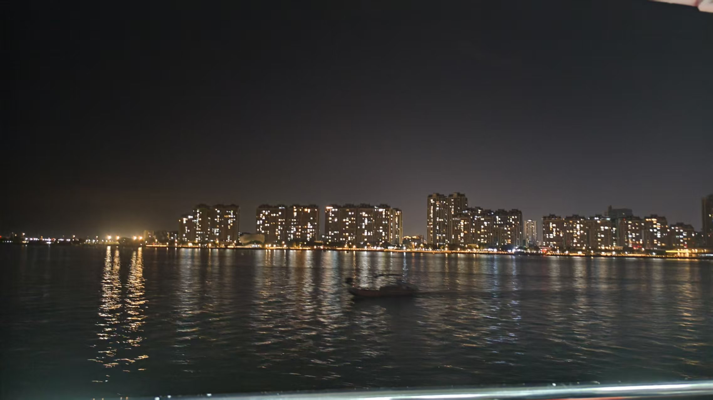

# 汕头一日游

lastday前的快乐时光!!!

<!-- more -->

#### 跑路

定的周五从快手跑路，今天周三早上去了趟公司后就去汕头玩耍了！

#### 攻略

忍饿一早上,中午两点汕头站下车,就直接打车去贵宾牛吃潮汕牛肉火锅了。

#### 贵宾牛潮汕牛肉火锅

强烈推荐牛筋丸，和沙茶酱配粿条吃很美味,饭挺贵的人均100吧，我一个人吃了120元

骑小电驴7公里到小公园玩耍

#### 去了小公园

汕头小公园是汕头的核心区域,文化馆、给阿嬷的情书剧景、桥批文化宫、汕头旅社都在里面，大概两小时可以逛完。

小公园里每一家牛肉丸都说自己是手打的:)

#### 体验 10 块钱的轮渡

1 块钱可以坐单程 10 分钟轮渡,晚霞的时候很方便欣赏海岸风景!!!,我坐的 25 来回的轮渡也很不错!

回深圳再回快手就到晚上23点了
